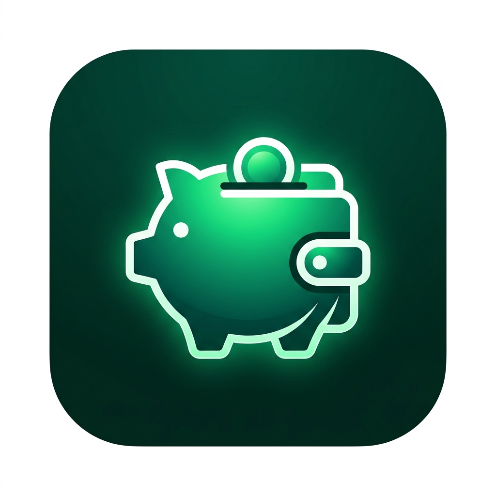

# 💰 SIMPanan — Offline & Secure Personal Finance Manager

<p align="center">
  
</p>

<p align="center">
  <a href="https://flutter.dev"></a>
  <a href="https://raw.githubusercontent.com/kevinvanmerligt/SIMPanan/main/patch/SIMPanan-v1.2.7.apk" download="SIMPanan-v1.2.7.apk"></a>
  <a href="./patch/patch-1.2.7.md"></a>
  <a href="#dynamic-theme-engine-system-light--dark"></a>
  <a href="#high-refresh-rate-display-support-60--144hz"></a>
  <a href="#apk-size-compression--optimization"></a>
  <a href="https://sqlite.org"></a>
  <a href="#100-offline-privacy--security"></a>
</p>

**SIMPanan** is a daily personal finance tracker engineered with a modern, interactive interface, **butter-smooth animations (60–144Hz)**, an **adaptive theme engine (System / Light / Dark modes)** with tailored green palettes, and complete **100% offline local privacy**. All your expense and income records remain strictly on your personal device without requiring an internet connection or third-party accounts.

---

## 📥 Download APK (Instant Direct Download)

Download and install the official **SIMPanan v1.2.7** APK directly onto your Android smartphone. The link below is optimized for direct stream downloading: **clicking the link begins downloading the APK immediately to your phone or computer without page redirects**.

<p align="center">
  <a href="https://raw.githubusercontent.com/kevinvanmerligt/SIMPanan/main/patch/SIMPanan-v1.2.7.apk" download="SIMPanan-v1.2.7.apk">
    
  </a>
</p>

### 🔗 Direct Download Links:
- 🚀 **[⬇️ Download SIMPanan v1.2.7 APK (Automatic Direct Download)](https://raw.githubusercontent.com/kevinvanmerligt/SIMPanan/main/patch/SIMPanan-v1.2.7.apk)**
- 🔗 **[GitHub Raw Mirror Download Link](https://github.com/kevinvanmerligt/SIMPanan/raw/main/patch/SIMPanan-v1.2.7.apk)**

> **Release File Metadata:**
> - **Filename:** `SIMPanan-v1.2.7.apk`
> - **Patch Version:** `1.2.7`
> - **Category:** Personal Finance Management / Expense Tracker
> - **Target OS:** Android 6.0+ (Marshmallow and above)
> - **Compressed Size:** ~20–25 MB (Optimized via R8 Code Minification & Resource Shrinking)
> - **Repository Path:** [`patch/SIMPanan-v1.2.7.apk`](https://raw.githubusercontent.com/kevinvanmerligt/SIMPanan/main/patch/SIMPanan-v1.2.7.apk)

### 📲 How to Install the APK on Android:
1. Tap the green **[Download APK v1.2.7]** button above. The APK file will download directly to your device.
2. Once the download completes, open the APK file via the notification drawer or your device's **Files / File Manager** app.
3. If an *"Install unknown apps"* prompt appears, enable permission for your browser or file manager.
4. Tap **Install**, then open and enjoy **SIMPanan**!

---

## 📦 Current Release Highlights: `Patch 1.2.7`

> 📄 Comprehensive release notes and changelog are documented in: **[`patch/patch-1.2.7.md`](./patch/patch-1.2.7.md)**

### ✨ What's New in Patch 1.2.7:
- 🐷 **Lively Kawaii Splash Entrance Animation (Smooth & Festive):**
  - Brand-new opening experience upon tapping and launching the application.
  - Chubby kawaii piggy bank mascot with animated blinking eyes `( • ‿ • )` ↔ `( ^ ‿ ^ )`, sweet rosy cheeks, and joyful wiggling ears.
  - Playful gold coin dropping into the piggy bank with physics-based elastic bounce (`Curves.elasticOut`).
  - Festive ambient sparkle field: 26 swirling golden stars (✨), floating mint bubbles, and micro-coins engineered with high-refresh-rate smoothness (60Hz–144Hz).
  - Rolling mini coin on a smooth pill progress track accompanied by whimsical dynamic status updates.
  - Quick "Skip" button for rapid access and an in-app "Putar Ulang Animasi (Splash)" button in Profile settings.
- 🪶 **Floating In-App Notification System (Bug Fix: Plus Button Stays Anchored):**
  - Resolved the layout defect where tapping *"Simpan Perubahan"* on the Profile tab triggered standard Scaffold SnackBars that pushed the center floating plus button (`+`) out of its bottom navigation notch.
  - Engineered an independent floating notification pill (`FloatingNotification` via `OverlayEntry`) that slides gracefully from the top with spring physics, status icons, and auto-dismiss.
  - Zero interference with the bottom navigation dock: **the center plus button (`+`) remains 100% stationary and anchored in its notch!**
- 🌓 **Dynamic Theme Engine (System, Light, Dark):**
  - Aligns with your device's global dark/light mode preference in real-time or allows permanent manual selection.
  - Tailored dual green palette: deeper forest green in light theme for crisp contrast, luminous mint emerald in dark theme for night-friendly radiance.
- ⚡ **R8 Code Minification & High Refresh Rate (60–144Hz):**
  - Ultra-compact ~20-25 MB APK package with butter-smooth micro-interactions.

---

## 📌 Version History & Patch Index

| Patch Version | Release Date | APK File | Key Highlights | Release Notes |
| :---: | :---: | :---: | :--- | :---: |
| **`v1.2.7`** *(Latest)* | October 26, 2026 | [⬇️ `SIMPanan-v1.2.7.apk`](https://raw.githubusercontent.com/kevinvanmerligt/SIMPanan/main/patch/SIMPanan-v1.2.7.apk) | Kawaii animated splash entrance (mascot, dropping coin, sparkles), floating notification overlay fixing plus button lift bug | [Read Patch 1.2.7 Notes](./patch/patch-1.2.7.md) |
| **`v1.2.2`** *(Previous)* | October 26, 2026 | [⬇️ `SIMPanan-v1.2.2.apk`](https://raw.githubusercontent.com/kevinvanmerligt/SIMPanan/main/patch/SIMPanan-v1.2.2.apk) | Dynamic theme engine (System/Light/Dark), dual adaptive green palette, massive APK compression to ~20-25 MB | [Read Patch 1.2.2 Notes](./patch/patch-1.2.2.md) |
| **`v1.1.11`** *(Archived)* | October 25, 2026 | *Superseded by v1.2.7* | Segmented transaction tabs with sliding pill animation, zero-lag native profile photo cropper (60-144Hz) | [Read Patch 1.1.11 Notes](./patch/patch-1.1.11.md) |
| **`v1.0.8`** *(Archived)* | October 25, 2026 | *Superseded by v1.2.7* | 60/90/120/144Hz high refresh rate, smooth page transitions, profile photo upload, 7-day expense chart | [Read Patch 1.0.8 Notes](./patch/patch-1.0.8.md) |
| **`v1.0.3`** *(Archived)* | October 25, 2026 | *Superseded by v1.2.7* | Cosmic vector logo, direct APK download, unified navigation headers across all tabs | [Read Patch 1.0.3 Notes](./patch/patch-1.0.3.md) |
| **`v1.0.0`** *(Initial Release)* | October 25, 2026 | *Superseded by v1.2.7* | Initial release: Realtime daily balance hero card, user profile, centered action dock, tab navigation | [Read Patch 1.0.0 Notes](./patch/patch-1.0.0.md) |

---

## ✨ Core Features

1. **📊 Realtime Daily Balance Hero Card**
   - Automatically computes remaining daily balance (**Income - Expenses**).
   - Instant overview of today's total income, total expenses, and transaction tally.
   - Formatted local calendar dates and day indicators.

2. **⚡ Quick Transaction Logging (Income & Expense)**
   - Instant modal sheet with iconic categories (*Food & Beverage, Shopping, Transport, Bills, Salary, Sales, etc.*).
   - Fast, responsive in-app numeric keypad; saves to local database in seconds.

3. **🌓 Adaptive Themes & Color System**
   - System auto-switching, permanent Light mode, or permanent Dark mode.
   - Specially calibrated green palette: darker and deeper in light mode for sharp readability, brighter and vibrant in dark mode for soft glowing clarity.

4. **📈 7-Day Expense Bar Chart**
   - Smooth animated bar chart powered by FlChart with horizontal grid lines.
   - Daily breakdown identifying trends, highest spending days, and a prominent "Today" highlight.

5. **📸 Profile & Interactive Photo Cropping (Zero Lag)**
   - Capture or select avatar photos from Camera or Gallery.
   - Built-in interactive cropper with rotation and smooth gestures running fluidly up to 144Hz.
   - Customizable name, age, and occupation tags.

6. **🔍 Flexible History & Search**
   - Filter transactions (*All*, *Income*, *Expense*) with proportional sliding pill tabs.
   - Realtime instant search by transaction title or category.
   - Swipe-to-delete action with confirmation.

7. **🥧 Category Spending Breakdown**
   - Aggregated total spending with category breakdown.
   - Visual percentage progress indicators for budgeting insights.

8. **🔒 100% Offline Privacy & Security**
   - Device-local SQLite database (`simpanan.db`).
   - Secure preferences stored with Android Keystore encryption.
   - Zero telemetry, no third-party analytics, no tracking, and no advertisements.

---

## 🗂️ Project Directory Structure

```text
c:\SIMPanan\
├── android\                    # Android native configuration, Proguard rules, Gradle setup
├── assets\
│   └── images\
│       └── logo.png            # Official SIMPanan logo asset
├── lib\
│   ├── core\                   # Theme engine, AppColors (dual palette), Rupiah & date utils
│   │   ├── constants\          # app_colors.dart (light/dark schemes), app_strings.dart
│   │   ├── database\           # SQLite local database helper & initial seed data
│   │   ├── theme\              # app_theme.dart (Material3 lightTheme & darkTheme)
│   │   ├── utils\              # currency_format.dart, date_format_id.dart
│   │   └── widgets\
│   │       ├── app_header.dart         # Global app header across navigation tabs
│   │       ├── fade_slide_entrance.dart # Ultra-smooth entry animations (60-144Hz)
│   │       └── floating_notification.dart # Floating notification overlay (prevents FAB jump bug)
│   ├── data\                   # Transaction models, category data, & profile repository
│   ├── features\
│   │   ├── beranda\            # Home tab with Hero Card, Quick Actions, 7-Day Chart
│   │   │   └── widgets\
│   │   │       └── transaksi_hari_ini_list.dart # Sliding pill segmented control
│   │   ├── catat_transaksi\    # Modal sheet for instant income & expense recording
│   │   ├── laporan\            # Category expense reports & progress bars
│   │   ├── navigation\         # Bottom navigation bar with animated PageView
│   │   ├── profil\             # Profile info, Theme Mode switcher, & Photo Crop screen
│   │   │   └── screens\
│   │   │       └── photo_crop_screen.dart # Interactive native photo cropper
│   │   ├── riwayat\            # Transaction history & instant search
│   │   └── splash\             # Kawaii animated splash entrance (mascot, sparkles, rolling coin)
│   │       └── screens\
│   │           └── splash_screen.dart
│   ├── providers\              # FinanceProvider & ThemeProvider (SharedPreferences)
│   ├── app.dart                # MultiProvider & MaterialApp themeMode wiring
│   └── main.dart               # High refresh rate initialization (60/90/120/144Hz)
├── patch\                      # Patch releases & APK distribution folder
│   ├── README.md               # Index of all release patches
│   ├── patch-1.2.7.md          # Patch 1.2.7 detailed release notes
│   ├── patch-1.2.2.md          # Patch 1.2.2 detailed release notes
│   ├── patch-1.1.11.md         # Patch 1.1.11 release notes
│   ├── patch-1.0.8.md          # Patch 1.0.8 release notes
│   ├── patch-1.0.3.md          # Patch 1.0.3 release notes
│   ├── patch-1.0.0.md          # Patch 1.0.0 initial release archive
│   └── SIMPanan-v1.2.7.apk     # Compressed release APK (~20-25 MB, direct download ready)
├── pubspec.yaml
└── README.md                   # Main project documentation
```

---

## 🔒 Private Repository & Project Access

> [!IMPORTANT]
> **NOTICE:** This project and source code repository is **private and exclusive to the owner/author (*Author Only*)**.
> 
> General cloning, redistribution, or execution of the source code on other machines is not supported or authorized for the public. Public users may only download and run the official compiled APK on their Android devices via the direct download link provided above.

---

## 📄 License
Copyright © 2026 SIMPanan. Designed for simple, elegant, and secure offline personal financial management.
