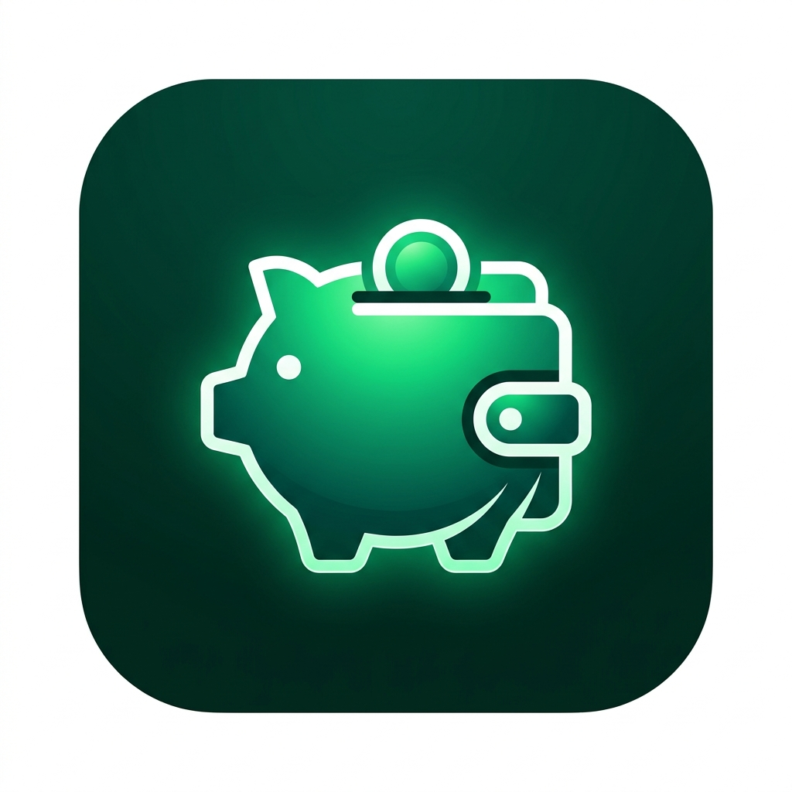

# 💰 SIMPanan — Personal Finance & Expense Manager

  

  
  
  

**SIMPanan** is a modern personal finance and expense tracker engineered with **ultra-smooth physics animations (60–144Hz)**, an **adaptive theme engine (System / Light / Dark modes)**, **custom multi-savings pockets & goal tracking**, **real-time balance transfer guard**, and a comprehensive **debt and liability tracking system**. All financial records are stored securely and locally on your device using SQLite.

---

## 📥 Download APK (Direct Download)

Download and install the official **SIMPanan v1.3.11** APK directly onto your Android smartphone. The link below is optimized for direct stream downloading: **clicking the link begins downloading the APK immediately without page redirects**.

  

### 🔗 Direct Download Links:
- 🚀 **[⬇️ Download SIMPanan v1.3.11 APK (Automatic Direct Download)](https://raw.githubusercontent.com/kevinvanmerligt/SIMPanan/main/patch/SIMPanan-v1.3.11.apk)**
- 🔗 **[GitHub Raw Mirror Download Link](https://github.com/kevinvanmerligt/SIMPanan/raw/main/patch/SIMPanan-v1.3.11.apk)**

> **Release File Metadata:**
> - **Filename:** `SIMPanan-v1.3.11.apk`
> - **Patch Version:** `1.3.11`
> - **Compressed Size:** ~20–22 MB
> - **Category:** Personal Finance Management / Multi-Savings & Debt Tracker
> - **Target OS:** Android 6.0+ (Marshmallow and above)
> - **Repository Path:** [`patch/SIMPanan-v1.3.11.apk`](https://raw.githubusercontent.com/kevinvanmerligt/SIMPanan/main/patch/SIMPanan-v1.3.11.apk)

### 📲 How to Install the APK on Android:
1. Tap the green **[Download APK v1.3.11]** button above. The APK file will download directly to your device.
2. Once the download completes, open the APK file via the notification drawer or your device's **Files / File Manager** app.
3. If an *"Install unknown apps"* prompt appears, enable permission for your browser or file manager.
4. Tap **Install**, then open and enjoy **SIMPanan**!

---

## 📦 Current Release Highlights: `Patch 1.3.11`

> 📄 Comprehensive release notes and changelog are documented in: **[`patch/patch-1.3.11.md`](./patch/patch-1.3.11.md)**

### ✨ What's New in Patch 1.3.11:
- 🎂 **Interactive Birth Date Picker & Automatic Age Calculation:**
  - Replaced manual numeric age entry with an interactive calendar date picker dialog.
  - Dynamically calculates user age in real-time and presents a neat age badge (e.g., "17 Tahun").
- 🔒 **Under-18 Occupation Lock ("Pelajar"):**
  - Users under 18 years of age have their occupation automatically locked to "Pelajar" with an amber lock indicator to ensure age-appropriate profiles.
- 👤 **Refined Name Field Placeholder UX:**
  - Displays "Pengguna" as a clean hint/placeholder rather than a hardcoded default string, making profile customization frictionless.
- 🎨 **Manual Custom HSL Color Palette for Savings Pockets:**
  - Create unique accent colors for savings pockets using custom HSL (Hue, Saturation, Lightness) slider controls, accompanied by live color preview and Hex codes.
  - Recommended color presets remain readily accessible for one-tap convenience.
- 📦 **Optimized Arm64 APK Binary (~20–22 MB):**
  - Built specifically for arm64-v8a architecture, ensuring fast load speeds, minimal download footprint, and smooth execution.

---

## 📌 Version History & Patch Index

| Patch Version | Release Date | APK File | Key Highlights | Release Notes |
| :---: | :---: | :---: | :--- | :---: |
| **`v1.3.11`** *(Latest)* | November 14, 2026 | [⬇️ `SIMPanan-v1.3.11.apk`](https://raw.githubusercontent.com/kevinvanmerligt/SIMPanan/main/patch/SIMPanan-v1.3.11.apk) | Birth date picker & auto age calculation, under-18 occupation lock, name placeholder UX, custom HSL color palette for savings | [Read Patch 1.3.11 Notes](./patch/patch-1.3.11.md) |
| **`v1.3.8`** *(Previous)* | November 12, 2026 | *Superseded by v1.3.11* | Top-level expense report, row-by-row savings management, transfer balance guard, debt tracking & deficit calculation | [Read Patch 1.3.8 Notes](./patch/patch-1.3.8.md) |
| **`v1.3.1`** *(Previous)* | November 9, 2026 | *Superseded by v1.3.11* | Multi-savings pockets, transaction allocation per pocket, inter-pocket transfers, ultra-smooth animations | [Read Patch 1.3.11 Notes](./patch/patch-1.3.1.md) |
| **`v1.2.10`** *(Previous)* | October 30, 2026 | *Superseded by v1.3.11* | New 3D glossy brand icon, unified high-contrast category chip checkmark, simplified "Simpan" action, UI polish | [Read Patch 1.2.10 Notes](./patch/patch-1.2.10.md) |
| **`v1.2.7`** *(Archived)* | October 26, 2026 | *Superseded by v1.3.11* | Kawaii animated splash entrance (mascot, dropping coin, sparkles), floating notification overlay | [Read Patch 1.2.7 Notes](./patch/patch-1.2.7.md) |
| **`v1.2.2`** *(Archived)* | October 26, 2026 | *Superseded by v1.3.11* | Dynamic theme engine (System/Light/Dark), dual adaptive green palette | [Read Patch 1.2.2 Notes](./patch/patch-1.2.2.md) |
| **`v1.1.11`** *(Archived)* | October 25, 2026 | *Superseded by v1.3.11* | Segmented transaction tabs with sliding pill animation, zero-lag native profile photo cropper (60-144Hz) | [Read Patch 1.1.11 Notes](./patch/patch-1.1.11.md) |
| **`v1.0.8`** *(Archived)* | October 25, 2026 | *Superseded by v1.3.11* | 60/90/120/144Hz high refresh rate, smooth page transitions, profile photo upload, 7-day expense chart | [Read Patch 1.0.8 Notes](./patch/patch-1.0.8.md) |
| **`v1.0.3`** *(Archived)* | October 25, 2026 | *Superseded by v1.3.11* | Cosmic vector logo, direct APK download, unified navigation headers across all tabs | [Read Patch 1.0.3 Notes](./patch/patch-1.0.3.md) |
| **`v1.0.0`** *(Initial Release)* | October 25, 2026 | *Superseded by v1.3.11* | Initial release: Realtime daily balance hero card, user profile, centered action dock, tab navigation | [Read Patch 1.0.0 Notes](./patch/patch-1.0.0.md) |

---

## ✨ Core Features

1. **📊 Realtime Daily Balance & Deficit Detection**
   - Automatically computes remaining daily balance (**Income - Expenses - Debts**).
   - Accurately highlights negative deficit balances in soft red when debts exceed income.

2. **🎯 Multi-Savings Pockets & Financial Goals**
   - Manage multiple independent savings pockets alongside your Main Savings.
   - Set targets, track milestone percentages, and customize pocket colors with HSL precision.
   - Quick deposit, quick withdraw, and guarded inter-pocket transfers.

3. **💳 Debt & Liability Management**
   - Record active debts with lenders, nominals, due dates, and notes.
   - Quick payment modal that links directly to savings pockets and logs expense transactions automatically.

4. **⚡ Quick Transaction Logging (Income & Expense)**
   - Instant modal sheet with iconic categories and pocket allocation.
   - Fast, responsive numeric keypad; saves to local SQLite database in seconds.

5. **🌓 Adaptive Themes & Color System**
   - System auto-switching, permanent Light mode, or permanent Dark mode.
   - Specially calibrated green palette: darker and deeper in light mode for sharp readability, brighter and vibrant in dark mode for soft glowing clarity.

6. **📈 7-Day Expense Bar Chart**
   - Smooth animated bar chart powered by FlChart with horizontal grid lines.
   - Daily breakdown identifying spending trends and highest spending days.

7. **📸 Profile & Interactive Photo Cropping (Zero Lag)**
   - Capture or select avatar photos from Camera or Gallery.
   - Built-in interactive cropper with rotation and smooth gestures running fluidly up to 144Hz.
   - Interactive calendar birth date picker with auto-computed age and youth protection guard.

8. **🔍 Flexible History & Search by Pocket**
   - Filter transactions (*All*, *Income*, *Expense*, or by specific *Savings Pocket*).
   - Realtime instant search by title, category, or pocket name.
   - Swipe-to-delete action with confirmation.

9. **🔒 Local SQLite Storage**
   - Device-local SQLite database (`simpanan.db`).
   - Android Keystore encrypted preferences.
   - Zero telemetry, no third-party analytics, no tracking, and no advertisements.

---

## 📄 License
Copyright © 2026 SIMPanan. Designed for simple, elegant, and secure personal financial management.
